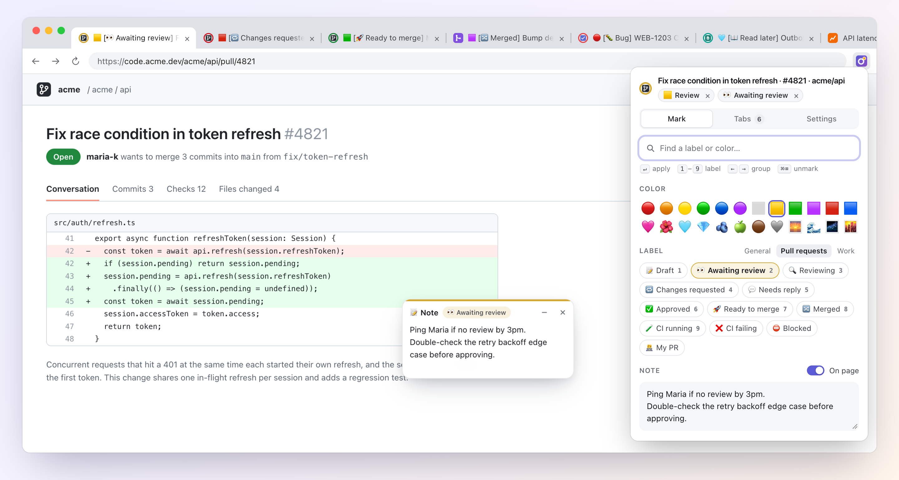
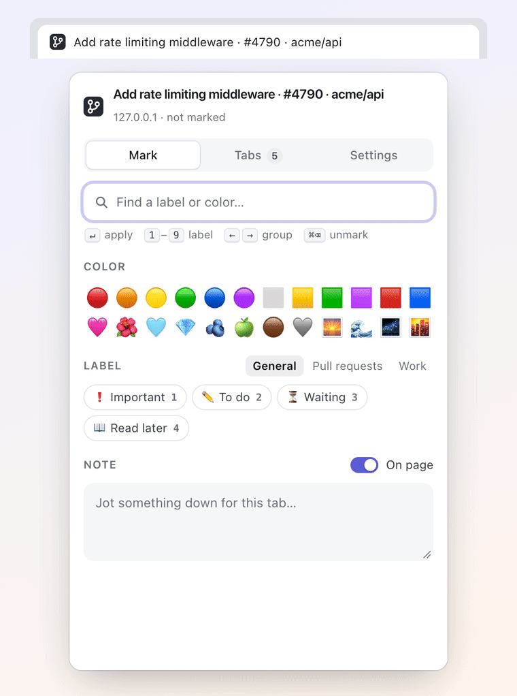
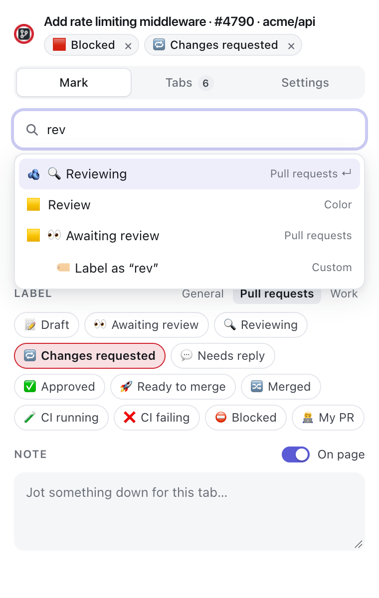
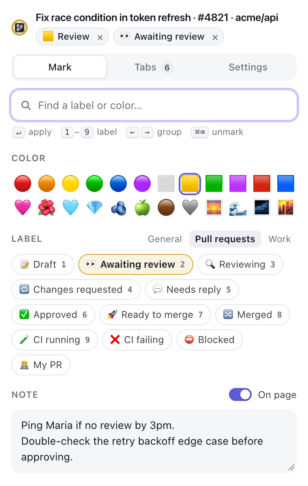
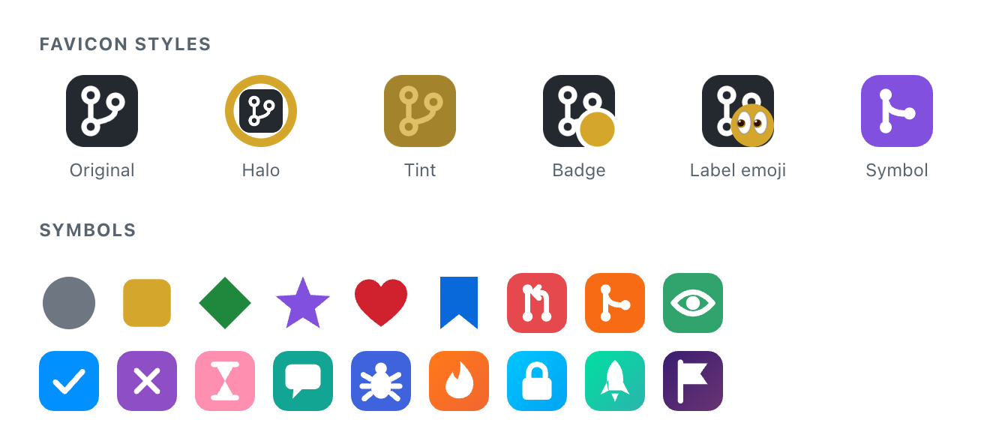
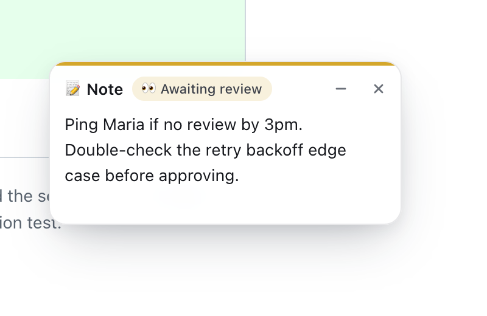
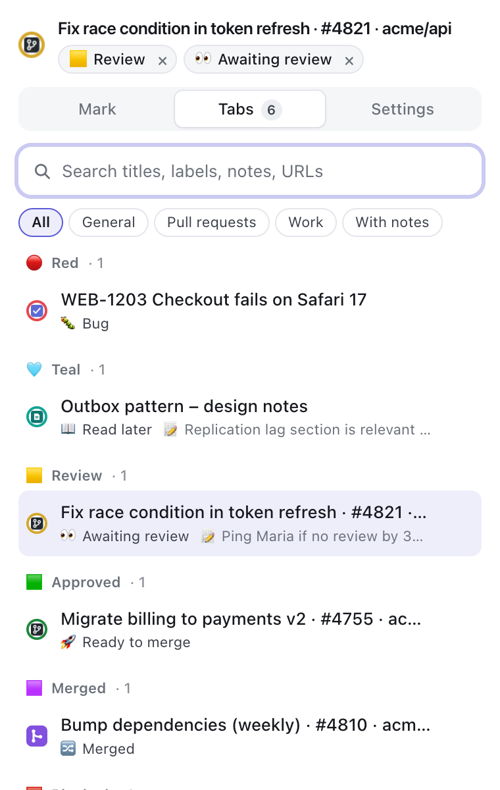
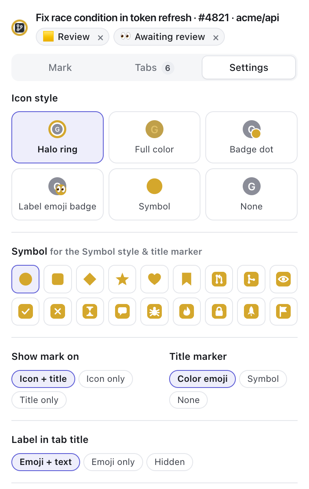
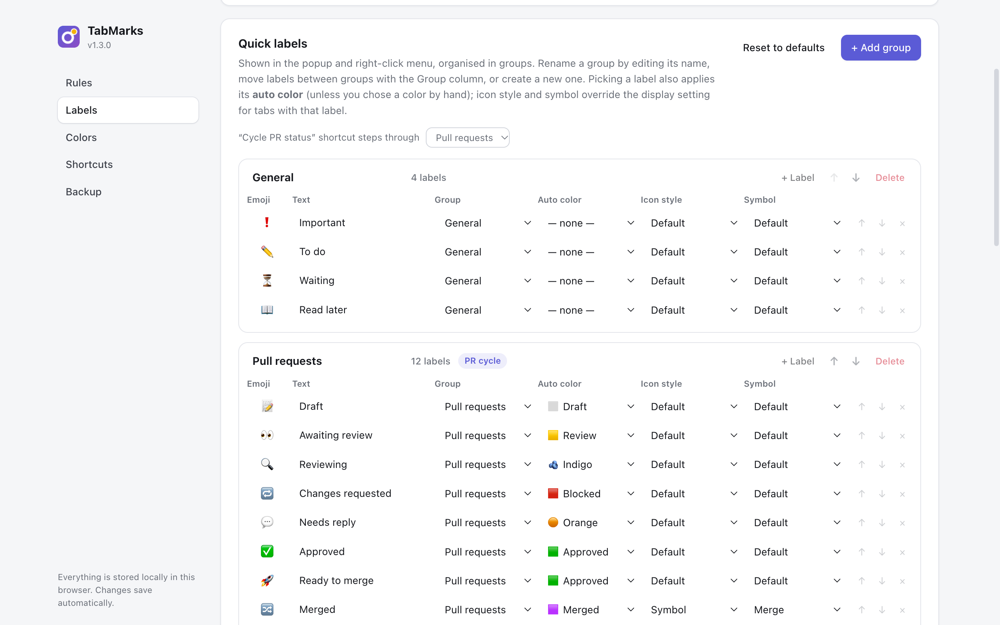

<p align="center">
  
</p>

<h1 align="center">TabMarks</h1>

<p align="center">
  <b>Color, label and annotate individual browser tabs with emojis, favicon marks and sticky notes.</b><br>
  Built for pull-request-heavy days. A free, open-source extension for Brave and Chrome by Anton Pushkin.
</p>

<p align="center">
  <a href="https://github.com/pushkinman/TabMarks/releases/latest"></a>
  
  
  
  <a href="LICENSE"></a>
</p>

<p align="center">
  <a href="https://github.com/pushkinman/TabMarks/releases/latest"><b>⬇ Download the latest version</b></a>
  &nbsp;·&nbsp; <a href="#install">Install</a>
  &nbsp;·&nbsp; <a href="#how-to-use">How to use</a>
  &nbsp;·&nbsp; <a href="#features">Features</a>
  &nbsp;·&nbsp; <a href="#keyboard-shortcuts">Shortcuts</a>
  &nbsp;·&nbsp; <a href="#updating-without-losing-data">Updating</a>
</p>

<p align="center">
  
</p>

## Why

With twenty tabs open, you can't tell which pull request is waiting on you, which one you already approved and which one is merged and can be closed. Tab groups move tabs around and hide titles. Bookmarks don't know what state anything is in.

TabMarks marks **the tab itself** and leaves your tab order alone. Give a tab a **color**, a **label** like `👀 Awaiting review` and a **note** like "ping Maria at 3pm". The mark shows up in the tab's favicon and title, so you can read the state of every tab at a glance. Notes float on the page as sticky notes. Marks survive browser restarts.

## Install

TabMarks isn't on the Chrome Web Store, so you load it from this repository. It takes a minute:

1. Download **`TabMarks-1.3.0.zip`** from the [latest release](https://github.com/pushkinman/TabMarks/releases/latest) and unzip it somewhere permanent, not Downloads. The browser loads the extension from that folder every time it starts.
   Or clone the repository, which makes updating a single `git pull`:
   ```bash
   git clone https://github.com/pushkinman/TabMarks.git
   ```
2. Open `brave://extensions`, or `chrome://extensions` in Chrome or `edge://extensions` in Edge.
3. Turn on **Developer mode** (top right).
4. Click **Load unpacked** and select the `TabMarks` folder (the one that contains `manifest.json`).
5. Pin TabMarks from the toolbar's extensions menu, then press **Alt+Shift+L** (⌥⇧L on a Mac) on any page.

Developed and tested in Brave. Any Chromium browser with Manifest V3 should work.

## How to use

1. **Open the popup** with **Alt+Shift+L** or the toolbar icon. The quick-pick box is already focused.
2. **Type a few letters** of a label or color, such as `awa` for *Awaiting review*, and press **Enter**. The tab's favicon gets a colored ring and its title becomes `🟨 [👀 Awaiting review] Fix race condition…`.
3. **Add a note** in the popup. It appears on the page as a sticky note that you can drag, collapse or hide. **Alt+Shift+O** toggles it.
4. **Find tabs later** in the popup's *Tabs* view, or jump between marked tabs with **Alt+Shift+N**.

<p align="center">
  
</p>
<p align="center"><sub>Type, Enter, done. With the box empty, <kbd>←</kbd> <kbd>→</kbd> switch label groups and <kbd>1</kbd>–<kbd>9</kbd> apply a label.</sub></p>

## Features

### A mark is a color, a label and a note

<table>
  <tr>
    <td width="33%"></td>
    <td width="33%"></td>
    <td width="33%"></td>
  </tr>
  <tr>
    <td align="center"><sub><b>Mark</b>: palette, labels, note</sub></td>
    <td align="center"><sub><b>Quick pick</b> matches labels and colors</sub></td>
    <td align="center"><sub>Light, dark or system theme</sub></td>
  </tr>
</table>

- **24 colors**: basic, extended, four gradients (Sunset, Ocean, Aurora, Twilight) and six dev colors (Draft, Review, Approved, Merged, Blocked, CI). You can also add unlimited custom colors, solid or two-stop gradient.
- **Up to 40 quick labels** in groups. The defaults are General, Pull requests and Work. You can add, rename, reorder and delete groups.
- **Labels carry colors.** *Awaiting review* also turns the tab Review-amber, unless you picked a color by hand.
- **Custom labels:** type anything that isn't a label and press Enter.
- Right-click any page → **TabMarks** for colors, labels and the note.

### Readable at a glance

<p align="center">
  
</p>

- **Favicon style:** halo ring, full tint, badge dot, the label's emoji, a symbol, or none. A label can override the style, so *Merged* shows a purple merge symbol by default.
- **18 symbols** including PR, merge, eye, check, cross, hourglass, comment, bug, flame, lock, rocket and flag.
- **Title marker:** the color's emoji (`🟥`), the symbol, or nothing.
- **Label in title:** emoji and text (`[👀 Awaiting review]`), emoji only (`👀`), or hidden.
- The title prefix stays put even when the site rewrites its title, for example with a `(3)` notification counter.

### Built for pull requests

| Group | Labels |
|---|---|
| **Pull requests** | 📝 Draft · 👀 Awaiting review · 🔍 Reviewing · 🔁 Changes requested · 💬 Needs reply · ✅ Approved · 🚀 Ready to merge · 🔀 Merged · 🧪 CI running · ❌ CI failing · ⛔ Blocked · 🧑‍💻 My PR |
| **Work** | 🐛 Bug · 🔥 Hotfix · 🚧 WIP · 📦 Release · 🚢 Deploy · 📌 Reference · 🧭 Investigating |
| **General** | ❗ Important · ✏️ To do · ⏳ Waiting · 📖 Read later |

- **Cycle PR status** with one shortcut (assign a key at `brave://extensions/shortcuts`). It steps through the *Pull requests* group, or any group you choose.
- **Rules** mark tabs automatically. Example: `github.com` plus the keyword `/pull/` → *Awaiting review*. A domain can include a path (`github.com/my-org`), and the keyword matches the URL or the title.

### Sticky notes on the page

<p align="center">
  
</p>

- Every tab can have a note. It floats on the page in a card that you can drag, collapse, hide and edit right there.
- **Alt+Shift+O** shows or hides it, and opens an empty note on a tab that has none.
- The site's own keyboard shortcuts are paused while you type in a note.
- Turn floating notes off everywhere, or per tab with **On page**.

### Find, restore, recover

<table>
  <tr>
    <td width="50%"></td>
    <td width="50%"></td>
  </tr>
  <tr>
    <td align="center"><sub><b>Tabs</b>: every marked tab, searchable</sub></td>
    <td align="center"><sub><b>Settings</b>: how marks look</sub></td>
  </tr>
</table>

- **Tabs view:** every marked tab, grouped by color. Search covers titles, labels, notes and URLs; filter by label group or *With notes*. Click a tab to jump to it.
- **Survives restarts.** Marks and notes come back after a browser restart or when you reopen a closed window.
- **⌘⇧T works too.** A tab you reopen (within an hour, in the same place) gets its mark and note back.
- **Recently closed:** closed tabs that had a mark or note are kept for 14 days. Click one to reopen it with its mark.
- A brand-new tab with the same URL still starts clean.

### Settings page



- **Rules**, **Labels** (emoji, text, group, auto color, icon style, symbol, order), **Colors** (title emoji, show or hide, custom colors), **Shortcuts** and **Backup**.
- **Export JSON** saves everything: settings, labels, rules, colors, and the notes and marks of open and recently closed tabs. **Import JSON** puts them back without overwriting anything.

<sub>All screenshots show TabMarks running in Brave on made-up demo pages.</sub>

## Keyboard shortcuts

| Shortcut | Action |
|---|---|
| **Alt+Shift+L** | Open the popup (quick label) |
| **Alt+Shift+M** | Mark the tab, or cycle through colors |
| **Alt+Shift+N** | Jump to the next marked tab (same color if this tab is marked) |
| **Alt+Shift+O** | Show / hide this tab's note |
| *unassigned* | Remove color and label (the note is kept) |
| *unassigned* | Cycle PR status |

**In the popup:**

| Keys | Action |
|---|---|
| type, then **Enter** | Apply the top match and close |
| **Shift+Enter** | Apply and keep the popup open |
| **↑ ↓** | Move through matches |
| **1**–**9** / **0** | Apply that label from the current group / clear the label |
| **← →** | Switch label group |
| **⌘⌫** | Unmark the tab |
| **Esc** | Clear the box, then close |

On a Mac, Alt is ⌥ Option. Chrome allows an extension only four default shortcuts, so the last two start unassigned. Change any of them at `brave://extensions/shortcuts`.

## Updating without losing data

Your marks, notes, labels, rules and settings are stored by the browser for the extension's ID, separately from the code, so updating the code never touches them.

- **To update:** run `git pull` in the folder, or unzip the new release over the old folder, then click ⟳ on TabMarks in `brave://extensions`. Open tabs keep their marks.
- **The extension ID is pinned** to `efndngfadgjplfknhdmghaooinnoakhe` by the `key` in `manifest.json`, whichever folder you load it from. Don't remove `key`, or the browser will treat TabMarks as a new, empty extension.
- **Never click Remove** in `brave://extensions`. That deletes the stored data. Use ⟳ or the on/off toggle instead.
- **Back up** from Settings → Backup → **Export JSON**.
- New versions add new settings with their defaults. Any change to how data is stored ships with a migration, never a reset.

## Permissions and privacy

| Permission | Needed for |
|---|---|
| Read and change all your data on websites | Prefixing tab titles, drawing the marked favicon and showing the sticky note |
| `tabs`, `sessions` | Knowing which tab is which, and restoring marks after a restart or ⌘⇧T |
| `storage` | Saving your marks, notes and settings locally |
| `contextMenus` | The right-click TabMarks menu |
| `scripting` | Updating tabs that were already open when TabMarks was installed or reloaded |
| `favicon`, `offscreen` | Reading a site's icon and converting SVG icons so the mark can be drawn on them |

Everything stays in `chrome.storage.local` on your computer. There's no account, sync, analytics or server. The only network requests TabMarks makes are fetches of a site's own favicon.

## Limits

- Browsers don't let extensions change `brave://` and `chrome://` pages, the Web Store or the built-in PDF viewer. The popup says so when you try to mark one.
- If a site's favicon can't be loaded at all, TabMarks draws a letter icon instead.

<details>
<summary><b>Code map</b></summary>

Plain JavaScript, no build step. Edit a file, then click ⟳ on TabMarks in `brave://extensions`.

| Path | What's inside |
|---|---|
| `manifest.json` | Permissions, shortcuts, pinned `key` |
| `src/background/sw.js` | Service worker: mark state, rules, restore pool, favicon rendering, menus, shortcuts |
| `src/content/content.js` | Title prefix, favicon swap, floating note (closed shadow DOM) |
| `src/popup/` | Toolbar popup: Mark, Tabs and Settings views |
| `src/options/` | Settings page: rules, labels and groups, colors, shortcuts, backup |
| `src/offscreen/` | Rasterizes SVG favicons (service workers can't decode SVG) |
| `src/lib/` | Shared constants, storage helpers, rules, symbols, favicon renderer |
| `src/ui/base.css` | Shared design tokens and components |
| `scripts/make-icons.py` | Regenerates `icons/` (pure Python) |

To work on the popup in a normal tab, open `chrome-extension://efndngfadgjplfknhdmghaooinnoakhe/src/popup/popup.html?tabId=<id>`.

</details>

## License

[MIT](LICENSE) © 2026 Anton Pushkin.

TabMarks is an independent project and isn't affiliated with Brave, Google, Microsoft or GitHub.
